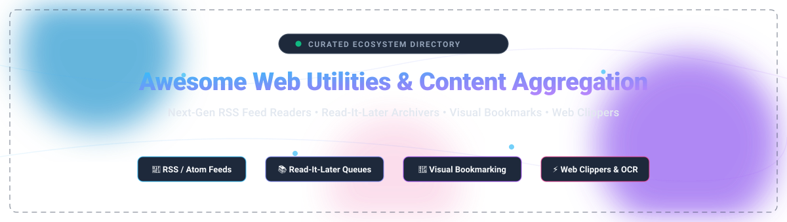

# Awesome Web Utilities & Content Aggregation 🚀

<div align="center">

<a href="https://github.com/ishandutta2007/Awesome-Awesome-Awesome"></a>
<a href="https://discord.gg/jc4xtF58Ve"></a>
<a href="https://github.com/ishandutta2007/Awesome-Web-Utilities-Content-Aggregation/stargazers"></a>
<a href="https://github.com/ishandutta2007/Awesome-Web-Utilities-Content-Aggregation/network/members"></a>
<a href="https://github.com/ishandutta2007/Awesome-Web-Utilities-Content-Aggregation/blob/main/LICENSE"></a>
<a href="https://github.com/ishandutta2007"></a>

<br/>
<br/>



</div>

## 🌐 Complete Directory of Top Web Utilities & Content Aggregation Solutions

A carefully curated directory and competitive analysis of premier **SaaS platforms** and **open-source projects** for modern web utilities, RSS/Atom feed syndication, full-text web clipping, visual bookmarking, and offline read-it-later systems.

*Discover the best self-hosted tools and hosted cloud platforms to reclaim your reading workflow, bypass algorithmic noise, defeat link rot, and master digital content curation.*

---

## 📑 Table of Contents
- [Sector Overview & Market Dynamics](#-sector-overview--market-dynamics)
- [SaaS & Hosted Platforms Comparison](#-saashosted-platforms)
- [Open-Source GitHub Projects](#-open-source-github-projects)
- [Key Selection Criteria & Architecture](#-key-selection-criteria--architecture)
- [Star History](#-star-history)
- [How to Contribute](#-how-to-contribute)
- [Support](#-support)
- [License & Disclaimer](#-license--disclaimer)

---

## 📊 Sector Overview & Market Dynamics

The global content curation and web syndication software market is currently estimated at **$1.8B – $2.5B**, expanding at a healthy Compound Annual Growth Rate (CAGR) of **12.3%** driven by severe algorithmic social media burnout, generative AI ingestion demands, and digital knowledge archival needs. 

The sector is **highly fragmented** rather than winner-take-all: while enterprise market intelligence platforms (such as Dassault Systèmes' Netvibes and Feedly Enterprise) serve high-ticket corporate threat intelligence, an expansive ecosystem of independent SaaS apps (e.g., Readwise Reader, Raindrop.io, Inoreader) and robust open-source, self-hosted engines (e.g., Huginn, RSSHub, Follow, changedetection.io, FreshRSS) thrive independently by tailoring specifically to power-readers, researchers, and privacy-first digital hoarders.

---

## ☁️ SaaS/Hosted Platforms

The table below ranks major SaaS and hosted content aggregation platforms sorted by company scale, valuation, and market capitalization (descending).

| Platform | Estimated Scale / Valuation / Revenue | Starting Tier Pricing | Free Tier / Trial Limit | Key Capabilities & Highlights |
| :--- | :--- | :--- | :--- | :--- |
| **[Netvibes](https://netvibes.com)** | Parent **Dassault Systèmes**: **~$45B Market Cap** ($6B+ ARR) | **€2.00 / month** (~$2.15/mo for legacy VIP tier; Enterprise custom quote) | Free plan limited to **5 custom dashboard tabs & basic public widgets** (Enterprise offers 14-day POC trial) | Executive corporate dashboard, social monitoring, and 3DEXPERIENCE data intelligence layer. |
| **[Flipboard](https://flipboard.com)** | **~$1.3B Valuation** ($175M+ VC funding, ~$50M ARR) | **$0.00 / month** (100% Free ad-supported reader; Brand ads custom) | **100% Free Forever** (Ad-supported, unlimited magazine creation & public feeds) | Visual magazine-style aggregator with ActivityPub/Fediverse integration and user-curated storyboards. |
| **[Feedly](https://feedly.com)** | **~$100M Implied Valuation** ($7.5M+ ARR, bootstrapped) | **$6.00 / month** ($72 billed annually for Pro) | Free plan limited to **100 sources & 3 personal feeds** (no AI, no full-text search) | AI-powered Leo assistant, threat intelligence tracking (CVEs/TTPs), and team research feeds. |
| **[daily.dev](https://daily.dev)** | **~$60M Implied Valuation** ($11M Seed funding, Aleph-backed) | **$14.99 / month** ($89.99/year for daily.dev Plus) | **Free Forever** (Unlimited developer feeds & reading queue; lacks custom folders, AI clean titles, and keyword filters) | Tech and developer news ecosystem curating engineering blogs, GitHub releases, and dev community squads. |
| **[Readwise Reader](https://readwise.io/read)** | **~$58M Implied Valuation** ($14M ARR, 100% bootstrapped) | **$9.99 / month** ($119.88 billed annually for Full Plan) | **30-day Free Trial** (Full unconstrained access to Reader, Ghostreader AI, and feeds; no permanent free tier) | Unified reading workflow syncing RSS feeds, newsletters, EPUBs, PDFs, YouTube transcripts, and spaced repetition. |
| **[UpContent](https://upcontent.com)** | **~$15M Implied Valuation** ($1.5M ARR) | **$15.00 / month** (Sharer tier) | Free plan limited to **1 User & 1 active Topic query** (14-day trial for higher team tiers) | B2B marketing curation platform delivering targeted third-party content to social schedulers and newsletters. |
| **[Inoreader](https://inoreader.com)** | **~$10M Implied Valuation** ($2M - $5M ARR, Innologica) | **$7.50 / month** ($89.99 billed annually for Pro) | Free plan limited to **150 feeds & basic search** (excludes newsletters, rules, WebSub, and automations) | Power-user RSS reader supporting automated rule engines, Webhook actions, Telegram ingestion, and filtering. |
| **[Raindrop.io](https://raindrop.io/)** | **~$10M Implied Valuation** ($3M+ ARR, bootstrapped indie) | **$3.00 / month** (~$28.00 billed annually) | Free plan with **unlimited bookmarks, collections, & nested tags**; file uploads capped at **100 MB/month** | All-in-one visual bookmark manager featuring masonry views, permanent page snapshots, and duplicate detection. |
| **[Instapaper](https://instapaper.com)** | **~$5M - $8M Valuation** ($1M+ ARR, bootstrapped) | **$5.99 / month** ($59.99 billed annually for Premium) | Free plan with **unlimited saves**, but restricted to **5 notes/highlights per month** and title-only search | Clean distraction-free read-it-later utility with mobile speed-reading, text-to-speech, and Kindle digest sync. |
| **[Feedbin](https://feedbin.com/)** | **~$3M - $5M Valuation** (Profitable solo-founder SaaS) | **$7.00 / month** ($70.00 billed annually) | **30-day Free Trial** (No credit card required; full access to feed sync & newsletter emails; no free tier) | Fast, uncluttered hosted RSS reader with dedicated email newsletter addresses and full third-party API support. |

---

## 🛠️ Open-Source GitHub Projects

The table below features the most popular and actively maintained open-source web aggregators, scrapers, bookmark managers, and offline archivers, **sorted strictly by GitHub stargazers count (descending)**. Every repository badge links directly to its live stargazers page.

| Repository | GitHub_Stars_Badge | Primary Language / Stack | Core Architecture & Use Case |
| :--- | :---: | :---: | :--- |
| **[Huginn](https://github.com/huginn/huginn)** | <a href="https://github.com/huginn/huginn/stargazers"></a> | Ruby / Rails | Self-hosted automated agent system that watches websites, monitors APIs, scrapes content, and emits custom RSS feeds. |
| **[RSSHub](https://github.com/DIYgod/RSSHub)** | <a href="https://github.com/DIYgod/RSSHub/stargazers"></a> | TypeScript / Node.js | Extensible RSS feed generator that crafts standard RSS/Atom feeds from social networks, newsletters, and arbitrary HTML pages. |
| **[Follow](https://github.com/RSSNext/Follow)** | <a href="https://github.com/RSSNext/Follow/stargazers"></a> | TypeScript / Next.js / Tauri | Next-generation universal information browser and aggregator supporting RSS, social platforms, AI translation, and media streams. |
| **[Glance](https://github.com/glanceapp/glance)** | <a href="https://github.com/glanceapp/glance/stargazers"></a> | Go | Ultra-clean self-hosted dashboard aggregating RSS feeds, Reddit subreddits, Twitch, YouTube channels, and bookmarks in YAML. |
| **[Changedetection.io](https://github.com/dgtlmoon/changedetection.io)** | <a href="https://github.com/dgtlmoon/changedetection.io/stargazers"></a> | Python / Playwright | Website change detection and content notification engine that turns dynamic webpage mutations into clean webhook/RSS updates. |
| **[Homepage](https://github.com/gethomepage/homepage)** | <a href="https://github.com/gethomepage/homepage/stargazers"></a> | JavaScript / Next.js | Modern, hyper-fast application dashboard with customizable RSS feed cards, bookmarks, search integration, and service metrics. |
| **[Karakeep](https://github.com/karakeep-app/karakeep)** | <a href="https://github.com/karakeep-app/karakeep/stargazers"></a> | TypeScript / Docker | Self-hosted "bookmark everything" archive with full-page snapshots (Monolith), video saving (`yt-dlp`), OCR, and Ollama AI tagging. |
| **[ArchiveBox](https://github.com/ArchiveBox/ArchiveBox)** | <a href="https://github.com/ArchiveBox/ArchiveBox/stargazers"></a> | Python / Django | Open-source internet preservation vault archiving bookmarks and RSS feeds into HTML, PDF, PNG, WARC, and git commits. |
| **[SingleFile](https://github.com/gildas-lormeau/SingleFile)** | <a href="https://github.com/gildas-lormeau/SingleFile/stargazers"></a> | JavaScript | Browser extension and CLI utility packaging complete webpages (styling, images, fonts, and DOM) into a single portable HTML file. |
| **[Linkwarden](https://github.com/linkwarden/linkwarden)** | <a href="https://github.com/linkwarden/linkwarden/stargazers"></a> | TypeScript / Next.js | Collaborative open-source bookmark manager collecting links and preserving immutable PDF, screenshot, and readability copies. |
| **[FreshRSS](https://github.com/FreshRSS/FreshRSS)** | <a href="https://github.com/FreshRSS/FreshRSS/stargazers"></a> | PHP / MySQL / SQLite | Lightweight, battle-tested self-hosted feed aggregator with multi-user support, WebSub notifications, and Google Reader API sync. |
| **[Omnivore](https://github.com/omnivore-app/omnivore)** | <a href="https://github.com/omnivore-app/omnivore/stargazers"></a> | TypeScript / Python | Full-featured open-source read-it-later client with newsletter addresses, PDF annotation, highlighting, and offline sync. |
| **[Monolith](https://github.com/Y2Z/monolith)** | <a href="https://github.com/Y2Z/monolith/stargazers"></a> | Rust | High-performance CLI tool bundling target web pages and all inline assets into a standalone HTML file for archival. |
| **[Wallabag](https://github.com/wallabag/wallabag)** | <a href="https://github.com/wallabag/wallabag/stargazers"></a> | PHP / Symfony | Self-hosted read-it-later application saving full articles, stripping distraction, and syncing across mobile and e-readers. |
| **[Shiori](https://github.com/go-shiori/shiori)** | <a href="https://github.com/go-shiori/shiori/stargazers"></a> | Go / Vue.js | Single-binary Pocket clone and bookmark manager with offline page content scraping and command-line management. |
| **[Homer](https://github.com/bastienwirtz/homer)** | <a href="https://github.com/bastienwirtz/homer/stargazers"></a> | Vue.js | Static, lightweight home server dashboard and bookmark launchpad configured entirely via YAML files. |
| **[Linkding](https://github.com/sissbruecker/linkding)** | <a href="https://github.com/sissbruecker/linkding/stargazers"></a> | Python / Django | Minimal, ultra-responsive self-hosted bookmark manager featuring automatic Wayback Machine archiving and clean tag filtering. |
| **[NetNewsWire](https://github.com/Ranchero-Software/NetNewsWire)** | <a href="https://github.com/Ranchero-Software/NetNewsWire/stargazers"></a> | Swift / Objective-C | Fast, native open-source RSS reader for macOS and iOS syncing directly with iCloud, FreshRSS, Miniflux, Feedbin, and NewsBlur. |
| **[Miniflux](https://github.com/miniflux/v2)** | <a href="https://github.com/miniflux/v2/stargazers"></a> | Go / PostgreSQL | Opinionated minimalist feed aggregator with zero clutter, keyboard shortcuts, built-in CSS extractors, and low memory footprint. |
| **[Fluent Reader](https://github.com/yang991178/fluent-reader)** | <a href="https://github.com/yang991178/fluent-reader/stargazers"></a> | TypeScript / Electron | Modern cross-platform desktop RSS client featuring Fluent Design, source grouping, regex rules, and cloud backend sync. |
| **[RSS-Bridge](https://github.com/RSS-Bridge/rss-bridge)** | <a href="https://github.com/RSS-Bridge/rss-bridge/stargazers"></a> | PHP | Extensible proxy generating Atom/RSS feeds for non-syndicated web pages, Twitter/X, Instagram, Telegram, and forums. |
| **[NewsBlur Core](https://github.com/samuelclay/NewsBlur)** | <a href="https://github.com/samuelclay/NewsBlur/stargazers"></a> | Python / Django | Complete open-source backend and frontend powering the NewsBlur personal news reader, featuring machine-learning intelligence training. |
| **[Read You](https://github.com/ReadYouApp/ReadYou)** | <a href="https://github.com/ReadYouApp/ReadYou/stargazers"></a> | Kotlin / Jetpack Compose | Gorgeous Android RSS reader styled with Material You, featuring Fever, FreshRSS, and Miniflux cloud synchronization. |
| **[Beehive](https://github.com/muesli/beehive)** | <a href="https://github.com/muesli/beehive/stargazers"></a> | Go | Flexible event-driven automation framework capable of bridging RSS feeds, webhook signals, chat applications, and social networks. |
| **[Yarr](https://github.com/nkanaev/yarr)** | <a href="https://github.com/nkanaev/yarr/stargazers"></a> | Go / Vue.js | Single-binary web feed reader with SQLite backend, zero dependencies, responsive mobile interface, and built-in full-text parser. |
| **[CommaFeed](https://github.com/Athou/commafeed)** | <a href="https://github.com/Athou/commafeed/stargazers"></a> | Java / TypeScript / React | Google Reader-inspired self-hosted feed aggregator built on Quarkus and React, optimized for high feed volumes and keyboard triage. |
| **[Tendedero](https://github.com/alejandrobujan/tendedero)** | <a href="https://github.com/alejandrobujan/tendedero/stargazers"></a> | Swift | Minimalist native macOS utility hanging screenshots and clipboard snippets on a virtual line above the menu bar with OCR search. |
| **[Grab-Site](https://github.com/ArchiveTeam/grab-site)** | <a href="https://github.com/ArchiveTeam/grab-site/stargazers"></a> | Python / wpull | Resilient archival web crawler for permanently capturing entire websites and complex web pages into standard WARC format files. |

---

## 🔍 Key Selection Criteria & Architecture

```
                                  ┌─────────────────────────────┐
                                  │   Target Content Sources    │
                                  │ (RSS, APIs, Newsletters, DOM)│
                                  └──────────────┬──────────────┘
                                                 │
                                                 ▼
               ┌─────────────────────────────────┴─────────────────────────────────┐
               │                                                                   │
               ▼                                                                   ▼
┌───────────────────────────────┐                                 ┌───────────────────────────────┐
│     Cloud SaaS Solutions      │                                 │   Self-Hosted Open Source     │
│   (Turnkey & Managed Feeds)   │                                 │   (Full Privacy & Control)    │
├───────────────────────────────┤                                 ├───────────────────────────────┤
│ • Feedly / Inoreader          │                                 │ • FreshRSS / Miniflux / Yarr  │
│ • Readwise Reader             │                                 │ • RSSHub / Changedetection.io │
│ • Raindrop.io                 │                                 │ • Karakeep / ArchiveBox       │
└───────────────────────────────┘                                 └───────────────────────────────┘
```

1. **Protocol Flexibility**: Does the aggregator support standard RSS, Atom, JSON Feed, WebSub (PubSubHubbub), and custom feed scraping via XPath/CSS selectors?
2. **Archival Fidelity**: Does the bookmarking tool preserve raw HTML, standalone snapshots (Monolith / SingleFile), visual screenshots, or standard archival WARCs?
3. **API & Client Compatibility**: Does the self-hosted reader implement the Google Reader API, Fever API, or custom REST APIs compatible with NetNewsWire, Reeder, and mobile readers?
4. **AI & Filtering Capabilities**: Does the engine support automated topic categorization, full-text boolean searching, regex filtering, and local LLM summarization (e.g., via Ollama)?

---

## 📈 Star History

[](https://star-history.com/#ishandutta2007/Awesome-Web-Utilities-Content-Aggregation&Date)

---

## 🤝 How to Contribute

Contributions are welcome! To submit a new tool, update an existing entry, or refine pricing benchmarks:

1. 🍴 Fork this repository.
2. 🌿 Create a feature branch: `git checkout -b feature/add-new-tool`.
3. ✍️ Add the SaaS or Open-Source project under the appropriate section following alphabetical/star order.
4. 📝 Ensure descriptions are factual, free tier limits are explicit, and links point to official endpoints.
5. 🚀 Open a Pull Request with a short summary of the addition.

---

## 💖 Support

If you found this curated ecosystem directory helpful, consider showing your support:

- ⭐ **Star this repository** to help others discover it on GitHub.
- 🍴 **Fork the repo** to keep an offline reference or contribute new utilities.
- 📢 **Share it** with friends, colleagues, and self-hosting communities!
- ☕ **Buy a coffee & sponsor**: Support active maintenance directly via the [GitHub Sponsor Dashboard](https://github.com/sponsors/ishandutta2007).

---

## 📜 License & Disclaimer

- Distributed under the **MIT License**. See [LICENSE](LICENSE) for details.
- *Disclaimer*: Product names, logos, brands, and trademarks featured or referred to within this repository are the property of their respective trademark holders. All pricing information and company estimates are accurate as of late 2026 and subject to change by vendors.
